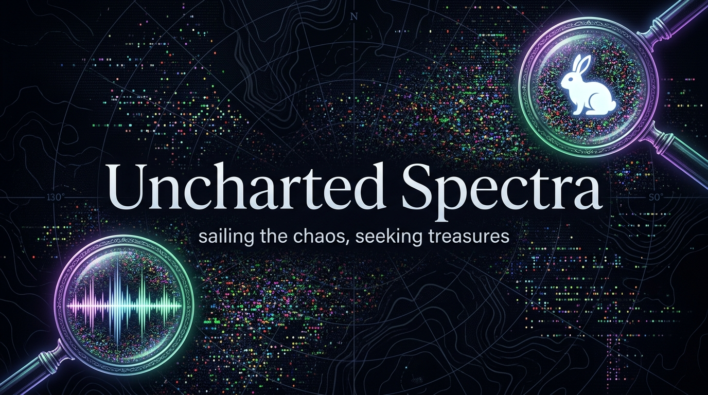

# Uncharted Spectra



> **Sailing the chaos, seeking treasures — image ⇄ sound dual-projection instrument**

**Uncharted Spectra** is a Go web application and DSP instrument that treats the boundary between audio and image as a single mutable data space. A WAV file and a 24-bit BMP file are **lossless, bidirectional projections of the same raw PCM byte buffer**.

---

## Core Features

* **Domain-Inverted Filtering:**
  * **Spatial Tab (Audio DSP on Image Planes):** `spatial_gain`, `spatial_filter` (lowpass/highpass/bandpass DoG), `spatial_distortion` (clip/tanh/foldback/posterize), `spatial_delay` (raster/horizontal/vertical multi-tap echo), `spatial_reverb` (Freeverb v2 comb/allpass diffusion), and `spatial_bitcrush` (sample-and-hold decimation + quantization).
  * **Temporal Tab (Photo Adjustments on Audio Stream):** `temporal_adjust` (brightness/contrast/levels gate), `temporal_blur` ($O(n)$ 3-pass Gaussian smoothing), and `temporal_fill` (region burst / Bernoulli salt entropy injection with RMS matching).
* **Terrain Controls:** Interactive rotary knobs (`shift ⇄`, `shift ⇅`, `randomize`) with live client-side BMP preview and fresh `/dev/urandom` entropy injection.
* **Entropy Scanner:** Hunts `/dev/urandom`, session snapshots, or uploaded files for structured signals using a composite **Structure Index (0–100)** combining 4096-point Hann FFT spectral flatness, normalized autocorrelation repetition, and spectral peakiness.
* **Export & Presets:** Download current state as `.wav` or `.bmp`, and export/import effect chains as `.json` presets with full undo/revert history.
* **100% Self-Contained Binary:** All web UI assets (including PWA offline support) are embedded directly into the executable via `//go:embed all:web`.

---

## Quick Start

### Run Prebuilt Binary
```bash
# Linux x86_64
./uncharted-spectra

# Raspberry Pi 5 (Linux ARM64)
./rpi5/uncharted-spectra
```
Then open **http://127.0.0.1:8484** in your browser.

### Build from Source
Requires Go ≥ 1.22:
```bash
# Host build
go build -o uncharted-spectra .

# Raspberry Pi 5 (linux/arm64) cross-build
CGO_ENABLED=0 GOOS=linux GOARCH=arm64 go build -o rpi5/uncharted-spectra .

# Run test suite
go test -v .
```
